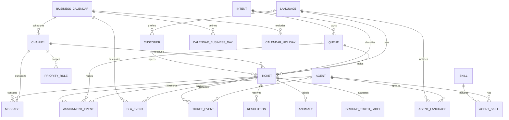

# Entity relationships

The diagram documents the normalized SQLite schema in `sql/schema.sql`. A crow's-foot means “many”; `||` means exactly one; `o|` means optional zero-or-one.

## Cardinalities and optionality

- One customer may open zero or many tickets; each ticket has exactly one customer.
- Each ticket references exactly one channel, intent, language, and queue. A channel can have many tickets.
- Each ticket has zero or many messages, assignment events, SLA events, lifecycle events, and resolution history records. Multiple SLA records may have the same type when a ticket is reopened; records are append-only and ordered by `started_at`, then `sla_id` for ties. The generator creates two initial SLA events per ticket (first response and resolution) and one baseline resolution result.
- An assignment event must reference one ticket and queue. Its agent is optional only for queue overflow; an agent can have many assignment-history records.
- Agent-to-skill and agent-to-language are many-to-many relationships implemented by `agent_skills` and `agent_languages`, each with a composite primary key and both foreign keys.
- A ticket has at most one label in `ground_truth_labels`; that row is optional in the schema but generated exactly once for every ticket.
- A ticket may have zero or one anomaly row, enforced by the unique `anomalies.ticket_id` index; each anomaly row references exactly one ticket.
- A business calendar has many weekday and holiday records. A channel and each SLA use one calendar.

## Effective dates and lifecycle history

`priority_rules.effective_from` and optional `effective_to` identify the applicable period. The schema prevents an end at or before the start; overlapping policy periods should be rejected by an application-level validation if rules become user-configurable. `tickets.status` represents the current lifecycle state. `ticket_events`, `assignment_events`, `sla_events`, and `resolutions` are append/history records so transfers, reopens, previous deadlines, and prior resolution attempts remain inspectable.

Foreign-key enforcement is switched on by `src/database.py`. `src/validate.py` additionally runs `PRAGMA foreign_key_check` and checks application-level relationships that SQL constraints cannot express.

## Database-enforced rules and application validation

The schema enforces primary/foreign keys, documented enum values, required fields, numeric bounds, parseable timestamps, ticket update ordering, SLA deadline ordering, and the anomaly cardinality rule. Initialization also adds null/empty primary-key guards to legacy SQLite tables whose older text-key declarations did not enforce `NOT NULL`. Triggers require channel timezone/hours and SLA calendar selection to match their referenced records. They also require each message timestamp to be on or after its ticket creation time and its channel to match the ticket, and prevent edits that would invalidate existing message history. SLA rows reject updates and deletes so corrections and reopened-ticket SLA cycles are recorded as new rows. `src/database.py` applies the versioned migration while preserving existing rows, checks legacy row consistency, and enables foreign keys on every connection.

IANA timezone names cannot be validated by SQLite and are checked by Python's `zoneinfo`. Legal lifecycle transitions, chronological event-stream consistency, effective-date overlap, and business rules such as complaint priority are validated in application code. SQL constrains event types and each non-null state to the documented enumerations but does not infer a legal transition from the pair.
